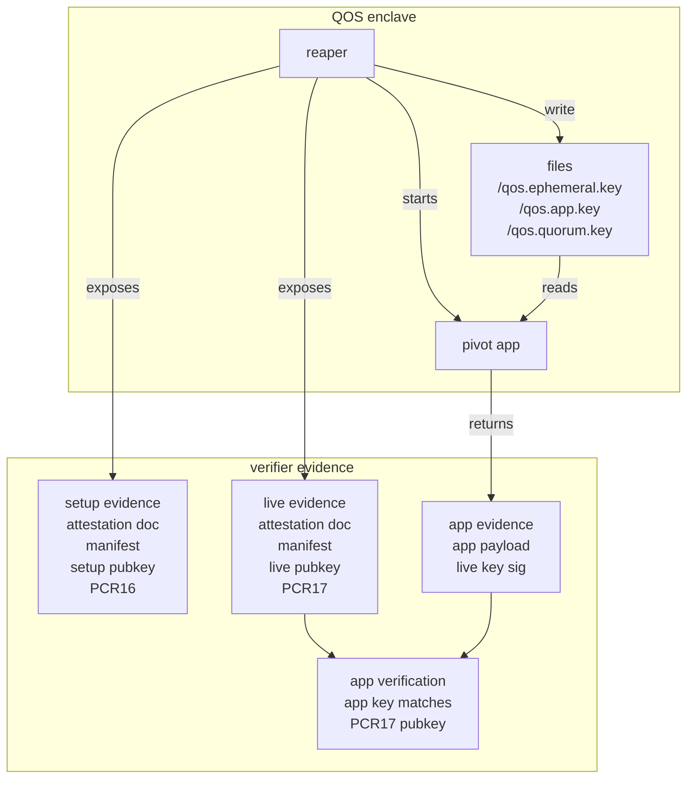

# Enclave Keys

This document is for QOS app authors who need to decide which enclave key to
use from a pivot app. It explains how the reaper, pivot app, manifest, quorum
key, app key and ephemeral key fit together.

For Boot Proof and App Proof concepts and verification details, see Turnkey's
[Proofs and Verification](https://docs.turnkey.com/features/verifiable-cloud/proofs-and-verification)
documentation. For the control-task and app-start mechanics, see
[QOS Networking](networking.md).

## Runtime Shape

A QOS enclave contains the reaper and the pivot app. The reaper owns the QOS
control path, writes the boot state files through QOS handles, and starts the
pivot app only after the manifest, pivot binary, and quorum key are present.

The control task (collapsed into the reaper in the above diagram) accepts boot, provisioning, key-forwarding, health, status, and
attestation requests. The pivot app is the application that runs after QOS has
finished provisioning key material.

## Files Available To The App

| File | Contents | App-author use |
| --- | --- | --- |
| `/qos.manifest` | The approved QOS manifest envelope. | Inspect the namespace, nonce, pivot configuration, quorum public key, quorum sets, and enclave PCR configuration. |
| `/qos.ephemeral.key` | The current enclave Ephemeral Key. | Sign enclave results, create App Proofs, and decrypt data encrypted to this specific enclave. |
| `/qos.app.key` | The App Key every enclave of this manifest shares. | Receive data any enclave of this manifest may open, such as a transport key clients encrypt to, without that data being recoverable outside an enclave. |
| `/qos.quorum.key` | The namespace Quorum Key. | Encrypt long-lived state and, when exact enclave attribution is not required, sign long-lived data. |

During standard boot and key forwarding, QOS creates both a setup Ephemeral Key
and a live Ephemeral Key. PCR16 commits the setup key and manifest hash for
provisioning and key-forwarding. PCR17 commits the live key and manifest hash
for app-level attestations. PCR18 commits only the manifest hash. QOS locks the full attestable PCR
range before publishing the boot files that allow the pivot app to start.

The setup key is written to `/qos.ephemeral.key` during boot and remains the
current Ephemeral Key while QOS processes provisioning or key injection. After
the Quorum Key is reconstructed or injected, QOS rotates `/qos.ephemeral.key` to
the precommitted live key before starting the pivot app. That keeps
application-level uses of the Ephemeral Key separate from setup-time key
transport.

## Quorum Key

The Quorum Key is the long-lived key for a namespace. Multiple enclaves in the
same namespace can receive the same Quorum Key after they satisfy the QOS
provisioning or key-forwarding protocol.

Use the Quorum Key when the data or identity should survive across enclave
instances, restarts, horizontal scaling, and application upgrades. Common uses:

- encrypting application state that should exist across application versions and enclave instances;
- signing data when the verifier only needs to know that a valid namespace enclave produced the signature.

## App Key

The App Key is shared by every enclave that boots one manifest, and exists only
inside those enclaves. A v2 manifest opts in by naming an `appKeyMinter`, a
hybrid public key; a manifest that names none has no App Key and pivots as soon
as it holds its Quorum Key. Manifest Set members vouch for the minter as for
every other key: `approve-manifest --app-key-minter-path` refuses a manifest
whose minter differs from the one they hold.

- A boot of such a manifest that has its Quorum Key but no App Key keeps the
  Quorum Key in memory, unwritten, and waits in `WaitingForAppKey`. That happens
  after shares are posted, and after a key forward from an enclave of another
  manifest.
- The minter orders exactly one waiting boot to mint: it signs
  `"qos_app_key_mint_order_v1" || manifest_hash || setup_ephemeral_binding`
  (`qos_client sign-app-key-mint-order`), and the boot checks the signature
  against the manifest's minter before minting (`mint-app-key`). The order names
  the boot's setup Ephemeral Key, which is fresh per boot, so it cannot be
  replayed to another boot; the host cannot mint without the minter.
- Every other boot of the manifest receives the App Key from an enclave of the
  same manifest, sealed to its setup Ephemeral Key and attested by the sender:
  carried with a key forward (see [Key Forward](key_forward.md)), or, for a boot
  already waiting, through `export-app-key` and `inject-app-key`.
- A refused order or App Key leaves the boot waiting, so a valid one can follow.
- It is never split into shares or wrapped to the disaster-recovery key, so no
  share threshold or key holder can rebuild it.

A new manifest gets a new App Key; nothing carries across. When every enclave of
a manifest is gone, its App Key is gone, and so is anything sealed to it; the
minter then orders a new one. Whoever holds the minter key can order a mint on a
second boot, giving the manifest two App Keys; neither leaks, since both exist
only in enclaves, and whoever consumes the App Key decides which one is
current.

Use the App Key when data should be readable by any enclave of this manifest
but never outside one. QOS does not attest the App Key itself: a pivot app that
publishes its public key does so in its own attestation request, with the key
or its digest in `user_data`, while PCR17 and PCR18 bind the manifest.

## Ephemeral Key

The Ephemeral Key is specific to an enclave instance. QOS uses two
stage-specific Ephemeral Keys:

- the setup key, verified with PCR16, for provisioning and key-forwarding;
- the live key, verified with PCR17, for app proofs and other post-provision
  uses.

The attestation document carries the selected key's 64-byte binding in
`public_key` (the hybrid key itself does not fit) and the manifest hash in
`user_data`; the full key travels beside the document. Verifiers check the key
against the binding, check PCR0 through PCR3 from the manifest, require the
release-pinned PCR range to be present, and recompute PCR16 or PCR17 for the
attestation stage they are verifying.

Most App Proof consumers only need the live/app check: verify the live
attestation against PCR17 and require the App Proof signature key to be the
live key whose binding the document attests. PCR16 is for setup-time provisioning and key
forwarding; it is only needed by verifiers that also want to tie an App Proof
back to the setup/QK-delivery event.

Use the Ephemeral Key when the output needs to be tied to a specific attested
enclave and the code/configuration identified by its manifest. Common uses:

- proving a response came from a particular enclave instance (App Proof);
- decrypting messages or secrets encrypted to this enclave's ephemeral public key.

For App Proof payload design and verifier behavior, see Turnkey's
[Proofs and Verification](https://docs.turnkey.com/features/verifiable-cloud/proofs-and-verification)
documentation.

## Related Docs

- [Proofs and Verification](https://docs.turnkey.com/features/verifiable-cloud/proofs-and-verification)
  explains Boot Proofs, App Proofs, and public verification tooling.
- [QOS Networking](networking.md) explains how the reaper starts the control
  task, bridge tasks, and pivot app.
- [Boot Standard](boot_standard.md) explains provisioning a fresh enclave from
  quorum key shares.
- [Key Forward](key_forward.md) explains provisioning a new enclave from an
  already provisioned enclave in the same namespace.
- [QOS Hybrid Key Set Specification](../src/qos_hybrid/SPEC.md) describes the key
  schemes used by QOS keys.
